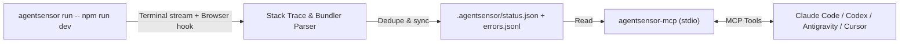

<div align="center">

# AgentSensor

**Zero-config runtime & browser error sensor for AI coding agents.**

Wrap your dev server with one command, then let Claude Code, Codex, Cursor, Antigravity, or any MCP client see the real crashes from your terminal and browser — mapped to the exact file and line, with zero copy-paste.

[](https://www.npmjs.com/package/agentsensor-mcp)
[](https://github.com/arif-js/agentsensor/actions/workflows/ci.yml)
[](LICENSE)
[](https://modelcontextprotocol.io)
[](https://glama.ai/mcp/servers/arif-js/agentsensor)
[](https://nodejs.org)

[What it does](#what-it-does) · [Supported stack](#supported-stack) · [Demo](#demo) · [Quick start](#quick-start) · [MCP tools](#mcp-tools) · [How it works](#how-it-works) · [Contributing](#contributing)

</div>

---

> **Status: pre-release (0.1).** Expect rapid improvements before 1.0.

## What it does

- ⚡ **Zero code changes:** wrap your existing dev script (`agentsensor run -- npm run dev`). No SDK imports, no middleware, no config files.
- 🌐 **Captures both server and browser crashes:** intercepts backend runtime exceptions, bundler compilation errors, and in-browser exceptions (`window.onerror`, `unhandledrejection`, React component errors).
- 🎯 **Source-mapped to your real code:** automatically enables `--enable-source-maps`, strips monorepo runner prefixes, collapses `node_modules` noise, and maps browser URLs back to exact workspace files.
- 📋 **Live `open` vs `resolved` status board:** maintains `.agentsensor/status.json` so fixed errors from earlier sessions never confuse the agent — while automatically reopening an error if it ever happens again.
- 🤖 **Automatic agent triggering:** sends MCP server instructions so connected agents check `get_runtime_errors` first whenever you report a bug or crash.
- 🔒 **100% local:** no accounts, no cloud, no telemetry, no background daemons.

AgentSensor doesn't guess fixes — it gives your coding agent the exact runtime reality (error type, message, source-mapped `file:line:column`, and the 30 log lines leading up to the crash) so the agent fixes the real bug on the first try.

## Supported stack

AgentSensor currently supports the **Node.js, JavaScript, and TypeScript** ecosystem:

| Layer | Supported | Details |
| :--- | :--- | :--- |
| **Runtimes** | Node.js (>=18.17) | JavaScript & TypeScript |
| **Frontend & SSR** | Next.js, Vite, Remix, Storybook | Dev server builds & browser crashes (`window.onerror`, `unhandledrejection`, React `console.error`) |
| **Backend** | Express, Fastify, NestJS, Koa, Node CLI scripts | V8 exceptions, unhandled promise rejections, source-mapped stack traces |
| **Compilers & Bundlers** | `tsc`, Turbopack, Webpack, esbuild, Babel | Build-time errors, type errors, syntax crashes |
| **Monorepos** | `pnpm`, Turborepo, Nx | Strips runner prefixes, maps local package paths |

> [!NOTE]
> **Non-Node runtimes (Python, Go, Rust):** Not supported yet. Dedicated runtime hooks and stack trace parsers for these languages are planned for upcoming releases.

## Demo

Run your dev server through `agentsensor`:

```sh
npx -y agentsensor-mcp run -- npm run dev
```

When your app or browser throws an error, just talk to your assistant naturally:

> **You:** The checkout page just crashed — fix it.
>
> **Claude:** *(calls `get_runtime_errors` → `get_error_detail`)*
> Found `OPEN` error `[9e84385bb1]`: `TypeError: Cannot read properties of undefined (reading 'code')` at `src/checkout/total.ts:17:38`.
> I added a guard for optional `coupon` in `calculateTotalCents` and called `check_fix` — error `[9e84385bb1]` is now marked `resolved` in `.agentsensor/status.json`.

## Who it's for

- **Developers using AI coding agents:** stop acting as the manual copy-paste bridge between terminal errors, Chrome DevTools, and chat windows (Claude Code, Codex, Antigravity, Cursor, Windsurf, Copilot).
- **Full-stack teams:** catch backend route crashes and frontend React component render errors in one unified stream.
- **Monorepo teams:** automatic workspace root detection and sub-package path resolution out of the box.

## Quick start

### 1. Run your dev server with `agentsensor`

Prefix your normal dev command with `npx -y agentsensor-mcp run --` (or install globally with `npm i -g agentsensor-mcp` and use `agentsensor run --`):

```sh
npx -y agentsensor-mcp run -- npm run dev
```

Your terminal output and colors stay completely unchanged, and `.agentsensor/` is automatically added to `.gitignore`.

### 2. Connect your AI coding agent (one-time setup)

#### Claude Code

```sh
claude mcp add agentsensor -- npx -y agentsensor-mcp
```

#### OpenAI Codex (`~/.codex/config.toml`)

```toml
[mcp_servers.agentsensor]
command = "npx"
args = ["-y", "agentsensor-mcp"]
```

#### Antigravity / Cursor / Windsurf / GitHub Copilot (`mcp_config.json`)

```json
{
  "mcpServers": {
    "agentsensor": {
      "command": "npx",
      "args": ["-y", "agentsensor-mcp"]
    }
  }
}
```

### 3. Trigger a bug and ask your agent

Ask your agent:

> *"Fix the error I just hit."*

## MCP tools

| Tool | Parameters | Description |
| :--- | :--- | :--- |
| `get_runtime_errors` | `since_minutes?`, `limit?` (default `10`), `all_sessions?`, `include_resolved?`, `project?` | Returns active `OPEN` errors from the current dev session (or last 24h), grouped by stack signature with `error_id`, `file:line:column`, occurrence count, and timestamps. |
| `get_error_detail` | `error_id`, `project?` | Returns the full source-mapped stack trace (user `[app]` frames highlighted, `node_modules` frames collapsed), the ~30 log lines before the crash, and the command/browser URL. |
| `check_fix` | `error_id`, `since?`, `project?` | Checks whether `error_id` recurred after a code edit. Reports `still_failing` or `not_seen` (and moves the error from `open` to `resolved` in `.agentsensor/status.json`). |
| `resolve_error` | `error_id?`, `project?` | Explicitly marks a specific `error_id` (or all currently open errors) as `resolved` in `.agentsensor/status.json`. Automatically reopens if triggered again. |

## How it works



1. **Terminal + Browser Capture:** `agentsensor run` spawns your dev command with `--enable-source-maps` and a lightweight preload hook (`agentsensor-mcp/register`). It watches `stdout`/`stderr` for server/bundler errors and automatically injects a tiny listener into `/@vite/client` and Next.js dev chunks to catch browser crashes (`window.onerror`, `unhandledrejection`, React `console.error`) via `POST /__agentsensor` on the same dev server port.
2. **Line-Number-Independent Fingerprinting:** Errors are hashed by error type, normalized message, and top app file/function (excluding line numbers so signatures stay stable even after the agent edits the file).
3. **Live Status Board (`.agentsensor/status.json`):** Every error starts in `open`. When the agent fixes the code and runs `check_fix` (or `resolve_error`), the error moves to `resolved`. If that error ever fires again later, it automatically moves back to `open`.
4. **Multi-Project Root Resolution:** `agentsensor-mcp` locates the right `.agentsensor/` directory using MCP client workspace `roots`, the `--project` flag / `AGENTSENSOR_PROJECT` env var, or by walking up from the current working directory.

## Try the included broken app

Clone the repo and run the planted-bug demo server:

```sh
git clone https://github.com/arif-js/agentsensor.git
cd agentsensor
npm install && npm run build
AUTO_TRIGGER=1 node dist/cli.js run -- npx tsx examples/broken-app/server.ts
```

Then ask your MCP-connected agent: *"Check runtime errors and fix the bug in `examples/broken-app/server.ts`."*

## Contributing

Issues and pull requests are welcome! Before submitting a PR:

```sh
npm run lint
npm run typecheck
npm test
npm run build
```

## License

[MIT](LICENSE)
